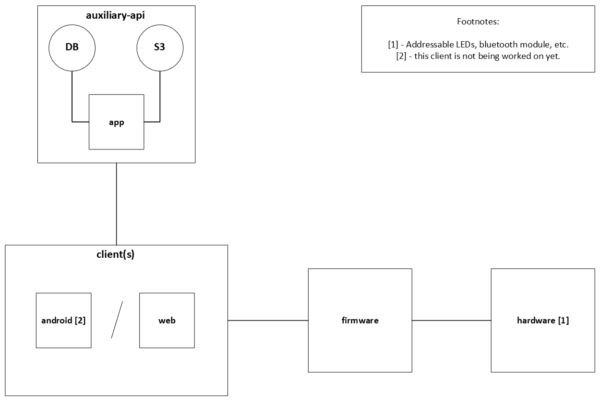
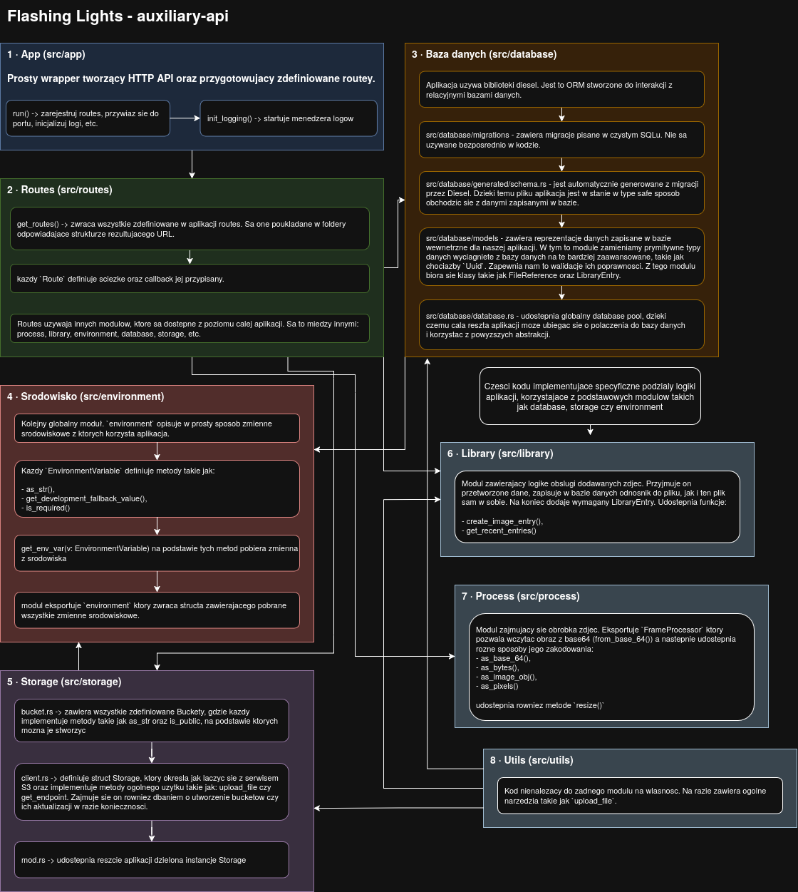
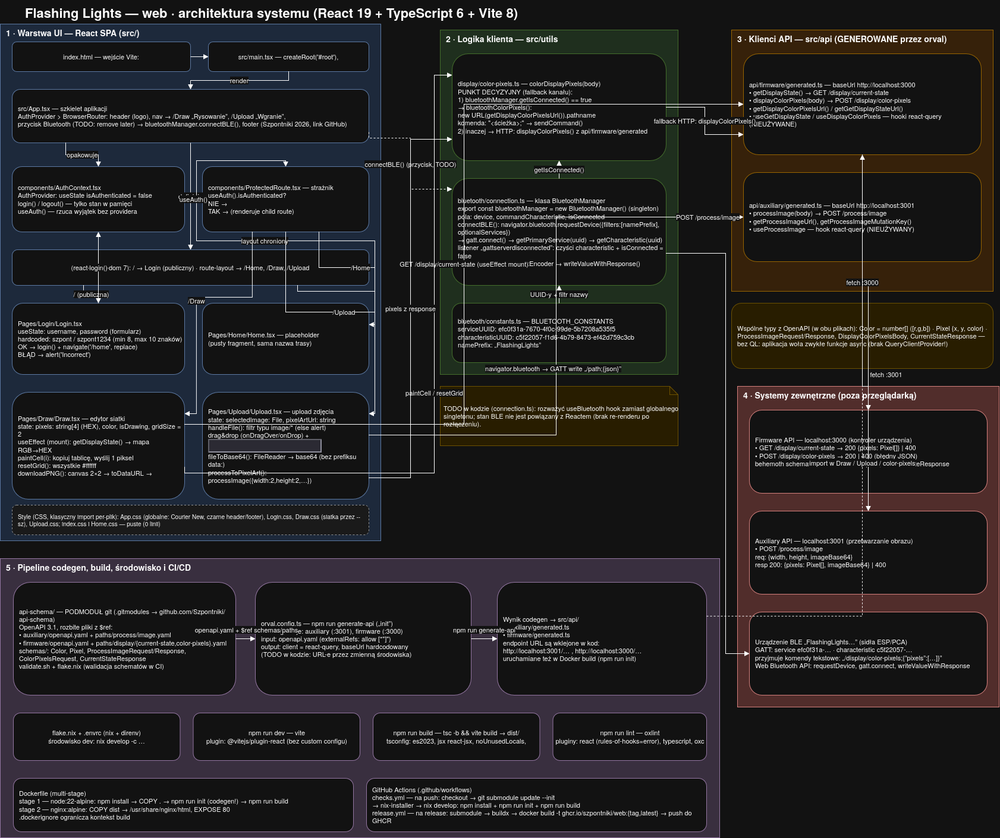
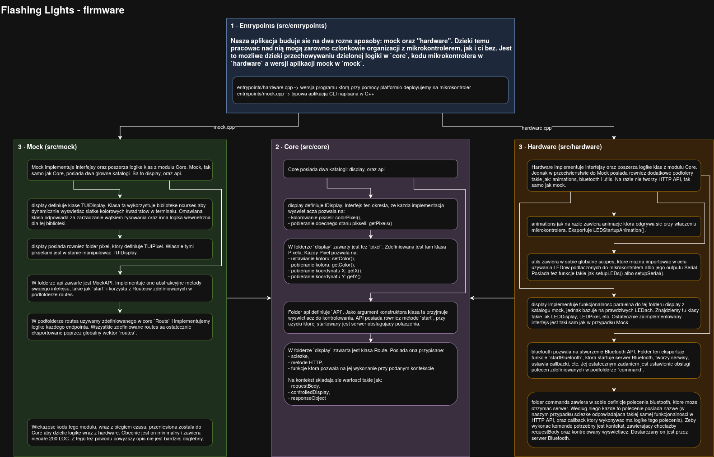

# Architecture

Please take a look at our project's architecture. The apps that you'll find below ([auxiliary-api](https://github.com/Szpontniki/auxiliary-api), [web](https://github.com/Szpontniki/web), and [firmware](https://github.com/Szpontniki/firmware)), are all open source and you're free inspect theirs code. We're using [PostgreSQL](https://github.com/postgres/postgres) as our database and [RustFS](https://github.com/rustfs/rustfs) as the S3 service.

You can take a look at how the individual apps are designed below. Sadly, due to the circumstances in which we're developing this project, they have to be localised to Polish. Apologies for any inaccessibility issues that this might produce.

